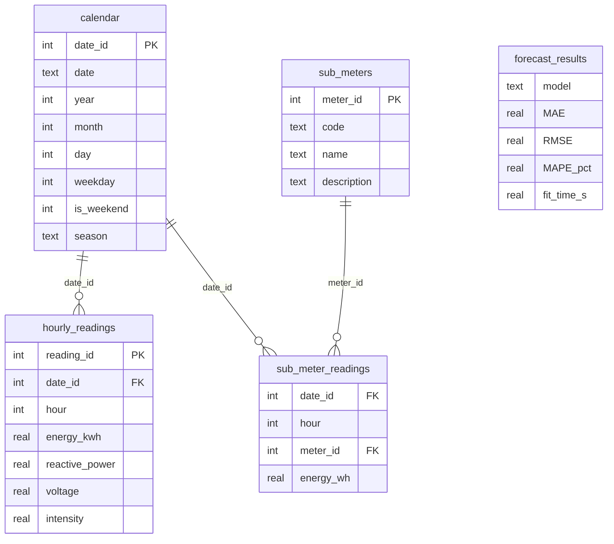

# Household Energy Consumption — анализ и прогноз потребления

**Тема №4, Cluster 1 (Exploratory Analytics, Time Series & Dashboards)**
Дисциплина «Programming for Data Analysis and Database», Applied Artificial Intelligence.
Команда: Rabat Karabek, Nurmukhanbet Sanzhar, Ussurbayeva Inkar — AAI-2603M.

Анализ суточных, недельных и сезонных паттернов нагрузки и пиков потребления электроэнергии одного дома
и сравнение простого прогноза с baseline (naive, seasonal naive, скользящее среднее, линейная регрессия на лагах).

## Данные

[UCI Individual Household Electric Power Consumption](https://archive.ics.uci.edu/dataset/235/individual+household+electric+power+consumption) —
2 075 259 поминутных измерений, 12.2006–11.2010, 127 МБ. Файл скачивается автоматически при первом запуске
(или вручную: распаковать архив в `data/raw/household_power_consumption.txt`).

## Запуск

```bash
python -m venv .venv
source .venv/bin/activate            # Windows: .venv\Scripts\activate
pip install -r requirements.txt

jupyter lab analysis.ipynb           # основной анализ: Run → Run All Cells (~1–2 мин)
python main.py                       # консольное меню
streamlit run dashboard.py           # дашборд с фильтрами
pytest                               # тесты
```

Google Colab: загрузить папку проекта, выполнить `!pip install -r requirements.txt`, открыть `analysis.ipynb`.

Порядок не важен: ноутбук и меню сами скачивают данные и строят кеш (Parquet, SQLite).
Дашборду нужен файл `data/processed/power_hourly.parquet` — он создаётся ноутбуком или пунктом 1 меню (если его нет, дашборд построит его сам).

## Структура

```
analysis.ipynb        главный ноутбук: EDA, временные ряды, SQL, прогноз, выводы
main.py               консольное меню (8 операций)
dashboard.py          Streamlit-дашборд: фильтры год / сезон / тип дня / подсчётчик
src/
  config.py           пути и константы
  data_loader.py      скачивание, чанковое чтение, float32, Parquet, бенчмарк CSV vs Parquet
  preprocessing.py    типы признаков, пропуски, IQR-выбросы, ресемплинг и заполнение пропусков
  timeseries.py       профили нагрузки, скользящие средние, STL/декомпозиция, пики, корреляции
  database.py         схема SQLite, загрузка, 10 SQL-запросов
  forecast.py         naive, seasonal naive, moving average, linear regression, метрики
  visualization.py    графики Matplotlib/Seaborn и интерактивные Plotly
  pipeline.py         общие шаги для ноутбука, меню и дашборда
tests/test_core.py    юнит-тесты (pytest)
results/              метрики, бенчмарк, графики (figures/*.png, *.html)
data/raw, processed   сырые данные, Parquet, energy.db (создаются кодом)
```

## ER-диаграмма



SQL-запросы (`src/database.py`, `QUERIES`): JOIN, GROUP BY/HAVING, подзапросы (в т.ч. коррелированный),
CTE, оконные функции `SUM OVER`, `AVG OVER ROWS`, `RANK`, `LAG`, `NTILE`. Результаты загружаются в Pandas.

## Основные результаты

| Подход к данным | Память DataFrame | Размер файла | Чтение |
|---|---|---|---|
| CSV, наивно (baseline) | 239 МБ (строки) | 127 МБ | быстро, но данные не готовы к анализу |
| CSV, чанки + float32 | 71 МБ | 127 МБ | ≈2 с |
| Parquet | 71 МБ | 22 МБ | ≈0,1 с |

Прогноз суточного потребления на день вперёд, test = 2010 год:

| Модель | MAE, кВт·ч/день | RMSE | MASE к naive |
|---|---|---|---|
| Linear regression (лаги) | 4,39 | 5,90 | 0,85 |
| Moving average (7) | 4,40 | 5,93 | 0,85 |
| Naive (baseline) | 5,19 | 7,12 | 1,00 |
| Seasonal naive (7) | 5,84 | 7,94 | 1,12 |

Подробные выводы — в конце `analysis.ipynb`.

## Соответствие требованиям

| № | Требование | Где |
|---|---|---|
| 1 | ≥ 5 функций | все модули `src/` |
| 2 | list / dict | `config.SUB_METERS`, `database.QUERIES`, `main.ACTIONS`, списки чанков |
| 3 | if / elif / else | `main.py` (меню, проверка ввода), `preprocessing.py` |
| 4 | for / while | меню и повторный ввод (`main.py`), чтение чанков, заполнение пропусков |
| 5 | Файлы | Parquet, CSV/JSON с результатами, `menu_state.json` |
| 6 | try / except | ввод чисел и дат, отсутствие файлов, ошибки БД и скачивания |
| 7 | UI | консольное меню `main.py` + дашборд `dashboard.py` |
| 8 | Модульность | 8 модулей в `src/`, стандартные `pathlib`, `json`, `datetime`, `sqlite3`, `zipfile` |
| 9 | Сравнение подходов | CSV vs Parquet (время, память); 4 модели прогноза (MAE, RMSE, время, память) |
| 10 | SQL | SQLite, ER-диаграмма, 10 запросов |
| 11 | Объём данных | 2,07 млн строк, chunksize, float32, Parquet |
